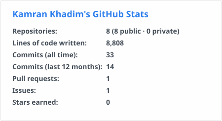
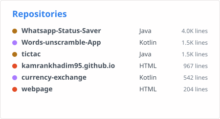

### Hi, 👋
I'm Kamran Khadim, a Senior Mobile Developer based in Dubai, UAE, specializing in building secure, scalable and high-performance Android and Flutter applications.

## About me
- 💼 Senior Mobile Developer at **The ENTERTAINER**
- 🌐 Portfolio: [kamrankhadim95.github.io](https://kamrankhadim95.github.io)
- 💬 Ask me about anything [here](https://github.com/kamrankhadim95/kamrankhadim95/issues)

## ✨My Stats

  
  

  

<!-- Cards are generated by .github/workflows/stats.yml (.github/scripts/build_cards.py) from public and private repositories and refreshed every 2 days. Private repository names are never published. -->
